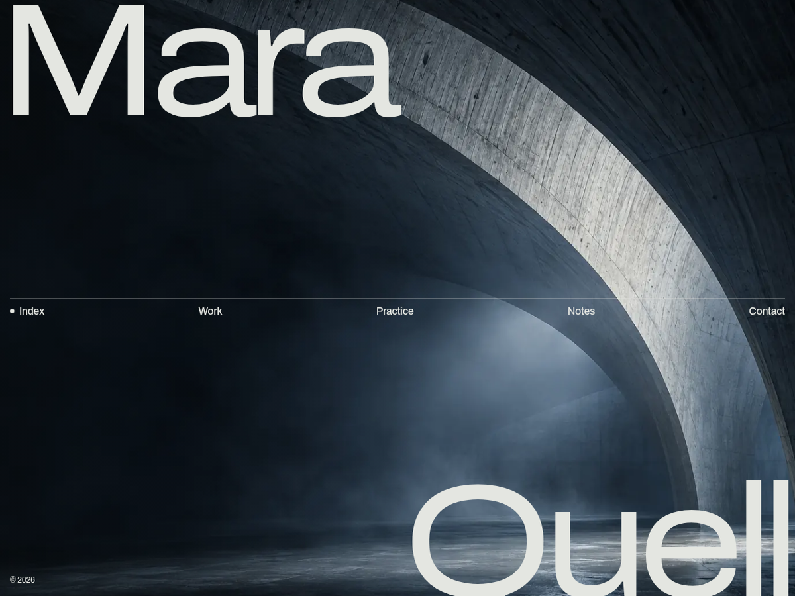

# Quell — free Next.js template with a working contact form

A one-page portfolio for an architect, a structural engineer or a small design studio, in a single index.html plus an img/ folder.



**Live demo:** https://quell.formgong.com · **Template page:** https://formgong.com/en/website-templates/quell/?utm_source=github&utm_medium=template&utm_campaign=quell-nextjs

[](https://app.netlify.com/start/deploy?repository=https://github.com/formgong-hq/quell-nextjs)
[](https://vercel.com/new/clone?repository-url=https://github.com/formgong-hq/quell-nextjs)
[](https://deploy.workers.cloudflare.com/?url=https://github.com/formgong-hq/quell-nextjs)

## Features

- One-page, responsive, fonts bundled (no Google Fonts requests)
- Contact form that works without a server, powered by [Formgong](https://formgong.com/?utm_source=github&utm_medium=template&utm_campaign=quell-nextjs&utm_content=features), a free form backend
- Spam protection (honeypot), success/error states from the real server answer
- Privacy page included · MIT licensed

## Quick start

```sh
npm install
npm run dev     # http://localhost:3000
npm run build   # static export in out/
```

## Contact form via Formgong

The form posts straight to `https://formgong.com/submit`; no backend, no PHP, no serverless function.


1. Create a form at https://formgong.com/new and copy its access key.
2. Open `content.json` and replace `fk_your_access_key` (under `form.access_key`) with that key. Every text of the page lives in the same file.
3. The form sends `access_key`, `subject`, `botcheck`, `name`, `email`, `project`, `location`, `timing`, `message`. The page shows thanks only when Formgong answers `success: true`.

Submissions arrive by email (and optionally Telegram, Slack or Discord). Formgong has a free plan: [create a free form](https://formgong.com/?utm_source=github&utm_medium=template&utm_campaign=quell-nextjs&utm_content=form-setup).

## Deploy

Build command: `npm run build` · Output directory: `out`. Works on Netlify, Vercel, Cloudflare and any static host.

## Files


```
app/
  sections/  (10 files)
  layout.jsx
  page.jsx
public/
  fonts/
    archivo-normal-100-900-62125-latin-ext.woff2
    archivo-normal-100-900-62125-latin.woff2
    OFL-Archivo.txt
  img/  (15 files)
  site.css
  site.js
.gitignore
content.json
jsconfig.json
LICENSE
next.config.mjs
package.json
```

## Images

The photos were generated for this template (ChatGPT image generation, OpenAI). The places and people are fictional. Replace them with your own before launch.

## Fonts

Archivo: bundled as WOFF2 files (Latin and Latin Extended), no requests to Google Fonts. SIL Open Font License 1.1, the licence texts are next to the font files.

MIT license.

## License

MIT © Formgong. Demo names, texts and photos are fictional sample content. Questions: support@formgong.com
